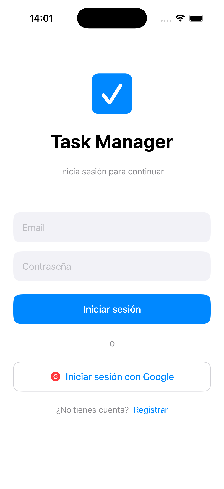
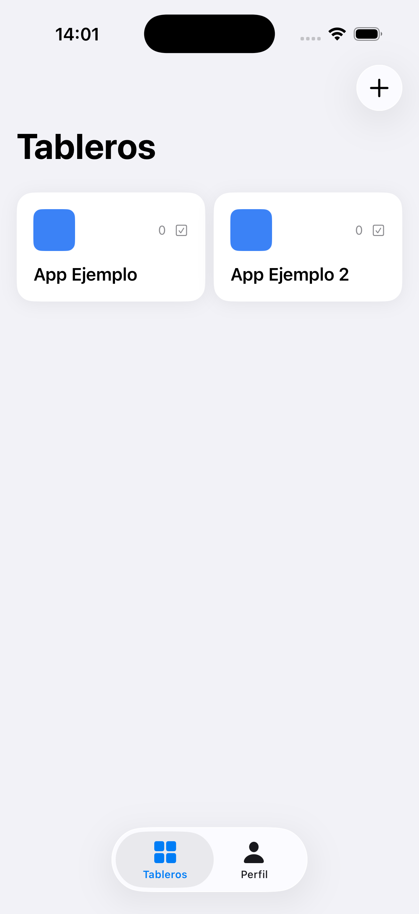
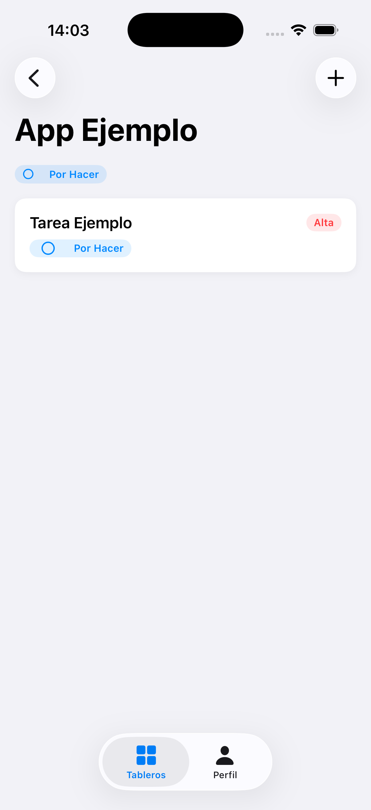
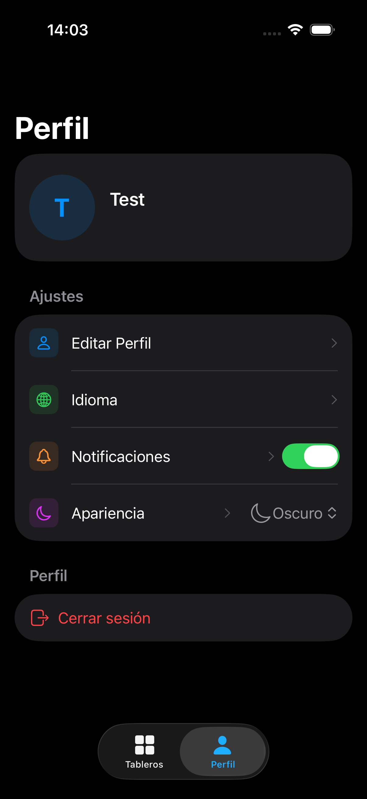
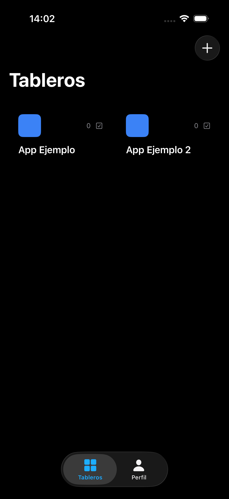
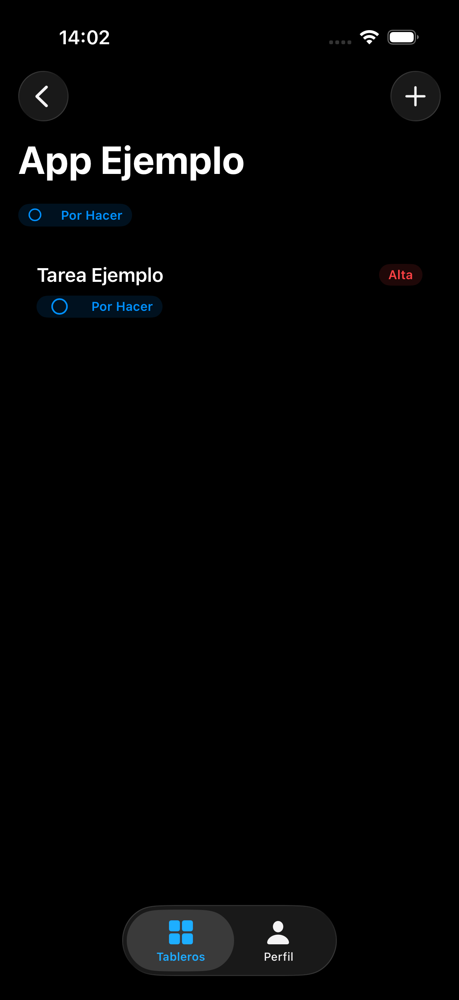

# Task Manager

A board-based task management app. Organise your work into custom boards, track tasks by priority and status, and stay on top of everything — with full dark mode support.

---

## 📱 Screenshots

<p align="center">
  
  
  
  
</p>
<p align="center">
  
  
</p>

---

## ✨ Features

- 📋 **Boards** — Create boards with custom colours and see task counts at a glance
- ✅ **Tasks** — Add tasks with priorities (High, Medium, Low) and statuses (To Do, In Progress, Done)
- 🌙 **Dark mode** — Automatic dark/light mode based on system settings
- 👤 **Profile** — Edit name, manage notifications, switch language and appearance
- 🌍 **Multilingual** — English and Spanish support

---

## 🛠️ Tech Stack

| Layer | Technology |
|---|---|
| Language | Swift (Xcode 26) |
| UI Framework | SwiftUI |
| State Management | `@Observable` + `@State` |
| Authentication | Firebase Auth (Email + Google) |
| Backend | .NET 10 REST API (Clean Architecture) |
| Database | Cloud Firestore |
| Infrastructure | Google Cloud Run |
| Logging | swift-log |
| Testing | Swift Testing |
| Dependency Management | Swift Package Manager |

---

## 🏗️ Architecture

The app follows **Clean Architecture** per feature. Views depend on ViewModels and domain abstractions only; the concrete implementations are the default arguments of each ViewModel.

```
TaskManager/
├── Core/
│   ├── Config/          # API and app configuration
│   ├── Errors/          # Failure types
│   ├── Logging/         # AppLogger (swift-log)
│   └── Network/         # API client with Firebase auth
└── Features/
    ├── Auth/            # Login, register, Google Sign-In
    ├── Boards/          # CRUD boards
    ├── Tasks/           # CRUD tasks, priorities, statuses
    └── Profile/         # Settings, notifications, language
```

Each feature follows the pattern:

```
Feature/
├── Data/
│   ├── DataSources/     # Remote API calls
│   ├── Models/          # DTO models
│   └── Repositories/    # Repository implementations
├── Domain/
│   ├── Entities/        # Domain entities
│   ├── Repositories/    # Abstract repository interfaces
│   └── UseCases/        # One use case per operation
└── Presentation/
    ├── Views/           # SwiftUI screens
    ├── ViewModels/      # @Observable ViewModels
    └── Components/      # Reusable UI components
```

---

## 🧭 Technical Decisions

- **Clean Architecture per feature.** Each feature has its own `Data / Domain / Presentation`. The domain layer only imports Foundation, so business rules can be tested without a device or Firebase.
- **`@Observable` ViewModels with an enum for each screen state.** `loading`, `loaded` and `error` are explicit cases, so a view cannot read data that is not there. No `ObservableObject` and no Combine.
- **`async/await` with typed errors.** Repositories and data sources `throw` a `Failure`; the ViewModels catch it, log it through `AppLogger` (swift-log) and turn it into screen state. Technical detail goes to the log, not to the user.
- **One use case per operation.** Every feature goes through use cases, so the rule is uniform. The trade-off is some thin classes that only forward the call.
- **Dependencies behind protocols, wired with default arguments.** Production code builds the real implementations through the ViewModel initialisers, and tests inject fakes. There is no DI container, which keeps the project small; the cost is that wiring lives in the initialisers.
- **Profile name saved API first, Firebase second.** Editing the name touches two systems that cannot be updated atomically. The API is saved first; if the Firebase update then fails, the previous name is restored in the API, so the user never ends up with two different names. The view does not import Firebase: it only calls ViewModels.
- **A network client that can be tested.** `NetworkClient` receives its `URLSession` and a token provider, so the tests run it against a stubbed `URLProtocol` and check the bearer header, status mapping and decoding without touching the network.
- **App Transport Security stays on.** The only exception is local networking, for development against `localhost`.
- **Shared .NET 10 API.** Business rules live on the server; the app sends the Firebase ID token. One backend serves all the apps in this portfolio.
- **Tests with Swift Testing and hand-written fakes.** ViewModels, repository mappings and the network client are covered with fakes of the domain protocols, with no mocking library.

### Other projects in this portfolio

| Project | Platform | Language |
|---|---|---|
| [finance-tracker](https://github.com/gcalvarez93/finance-tracker) | Flutter (iOS + Android) | Dart |
| [habit-tracker](https://github.com/gcalvarez93/habit-tracker) | Flutter (iOS + Android) | Dart |
| [task-manager](https://github.com/gcalvarez93/task-manager) | iOS | Swift |
| [budget-scanner](https://github.com/gcalvarez93/budget-scanner) | iOS | Swift |
| [recipe-manager](https://github.com/gcalvarez93/recipe-manager) | Android | Kotlin |
| [workout-tracker](https://github.com/gcalvarez93/workout-tracker) | Android | Kotlin |
| [castrodev-api](https://github.com/gcalvarez93/castrodev-api) | Shared backend | C# (.NET 10) |

---

## 🚀 Getting Started

### Prerequisites

- Xcode 26+
- iOS 26+ (simulator or device)
- Firebase project configured
- API running at `api.castrodev.com` or locally

### Installation

```bash
# Clone the repository
git clone https://github.com/gcalvarez93/task-manager.git

# Open in Xcode
open TaskManager.xcodeproj
```

Then:

1. Add your `GoogleService-Info.plist` to the main target in Xcode
2. Set the API URL in the `API_URL` key of `Info.plist` (defaults to `https://api.castrodev.com`; if the key is missing the app falls back to `http://localhost:5166`)
3. Swift Package Manager dependencies resolve automatically on first open
4. Build and run with `⌘R`

### Running Tests

```bash
xcodebuild test \
  -scheme TaskManager \
  -destination 'platform=iOS Simulator,name=iPhone 17'
```

---

## 🔗 Related

- [CastroDev API](https://github.com/gcalvarez93/castrodev-api) — Shared .NET 10 backend
- [castrodev.com](https://castrodev.com) — Portfolio

---

---

# Task Manager

App de gestión de tareas por tableros. Organiza tu trabajo en tableros personalizados, controla tus tareas por prioridad y estado, y mantén todo bajo control — con soporte completo de modo oscuro.

---

## ✨ Funcionalidades

- 📋 **Tableros** — Crea tableros con colores personalizados y consulta el número de tareas de un vistazo
- ✅ **Tareas** — Añade tareas con prioridades (Alta, Media, Baja) y estados (Por Hacer, En Progreso, Completado)
- 🌙 **Modo oscuro** — Modo oscuro/claro automático según el sistema
- 👤 **Perfil** — Edita tu nombre, gestiona notificaciones, cambia el idioma y la apariencia
- 🌍 **Multiidioma** — Soporte para español e inglés

---

## 🛠️ Stack Tecnológico

| Capa | Tecnología |
|---|---|
| Lenguaje | Swift (Xcode 26) |
| UI Framework | SwiftUI |
| Estado | `@Observable` + `@State` |
| Autenticación | Firebase Auth (Email + Google) |
| Backend | API REST .NET 10 (Clean Architecture) |
| Base de datos | Cloud Firestore |
| Infraestructura | Google Cloud Run |
| Logging | swift-log |
| Tests | Swift Testing |
| Gestión de dependencias | Swift Package Manager |

---

## 🧭 Decisiones Técnicas

- **Clean Architecture por feature.** Cada feature tiene su propio `Data / Domain / Presentation`. La capa de dominio solo importa Foundation, así que las reglas de negocio se prueban sin dispositivo ni Firebase.
- **ViewModels `@Observable` con un enum por estado de pantalla.** `loading`, `loaded` y `error` son casos explícitos, y la vista no puede leer datos que no existen. Sin `ObservableObject` ni Combine.
- **`async/await` con errores tipados.** Los repositorios y data sources lanzan un `Failure`; los ViewModels lo capturan, lo registran con `AppLogger` (swift-log) y lo convierten en estado de pantalla. El detalle técnico va al log, no al usuario.
- **Un caso de uso por operación.** Todas las features pasan por casos de uso, así que la regla es uniforme. El inconveniente son algunas clases finas que solo reenvían la llamada.
- **Dependencias tras protocolos, enlazadas con argumentos por defecto.** El código de producción construye las implementaciones reales en los inicializadores de los ViewModels, y los tests inyectan fakes. No hay contenedor de DI, lo que mantiene el proyecto pequeño; el coste es que el enlazado vive en los inicializadores.
- **Nombre de perfil: primero API, después Firebase.** Editar el nombre toca dos sistemas que no se pueden actualizar de forma atómica. Se guarda primero en la API; si después falla Firebase, se restaura el nombre anterior en la API, de modo que el usuario nunca acaba con dos nombres distintos. La vista no importa Firebase: solo llama a ViewModels.
- **Un cliente de red que se puede probar.** `NetworkClient` recibe su `URLSession` y un proveedor de token, así que los tests lo ejecutan contra un `URLProtocol` simulado y comprueban la cabecera bearer, el mapeo de códigos HTTP y la decodificación sin tocar la red.
- **App Transport Security activado.** La única excepción es la red local, para desarrollar contra `localhost`.
- **API compartida en .NET 10.** Las reglas de negocio viven en el servidor; la app envía el token de Firebase. Un solo backend sirve a todas las apps de este portfolio.
- **Tests con Swift Testing y fakes escritos a mano.** Los ViewModels, los mapeos de repositorios y el cliente de red están cubiertos con fakes de los protocolos del dominio, sin librería de mocks.

### Otros proyectos del portfolio

| Proyecto | Plataforma | Lenguaje |
|---|---|---|
| [finance-tracker](https://github.com/gcalvarez93/finance-tracker) | Flutter (iOS + Android) | Dart |
| [habit-tracker](https://github.com/gcalvarez93/habit-tracker) | Flutter (iOS + Android) | Dart |
| [task-manager](https://github.com/gcalvarez93/task-manager) | iOS | Swift |
| [budget-scanner](https://github.com/gcalvarez93/budget-scanner) | iOS | Swift |
| [recipe-manager](https://github.com/gcalvarez93/recipe-manager) | Android | Kotlin |
| [workout-tracker](https://github.com/gcalvarez93/workout-tracker) | Android | Kotlin |
| [castrodev-api](https://github.com/gcalvarez93/castrodev-api) | Backend compartido | C# (.NET 10) |

---

## 🚀 Instalación

### Requisitos previos

- Xcode 26+
- iOS 26+ (simulador o dispositivo)
- Proyecto Firebase configurado
- API disponible en `api.castrodev.com` o en local

### Pasos

```bash
# Clonar el repositorio
git clone https://github.com/gcalvarez93/task-manager.git

# Abrir en Xcode
open TaskManager.xcodeproj
```

A continuación:

1. Añade tu `GoogleService-Info.plist` al target principal en Xcode
2. Indica la URL de la API en la clave `API_URL` de `Info.plist` (por defecto `https://api.castrodev.com`; si la clave no existe, la app usa `http://localhost:5166`)
3. Las dependencias de Swift Package Manager se resuelven automáticamente al abrir el proyecto
4. Compila y ejecuta con `⌘R`

### Tests

```bash
xcodebuild test \
  -scheme TaskManager \
  -destination 'platform=iOS Simulator,name=iPhone 17'
```
